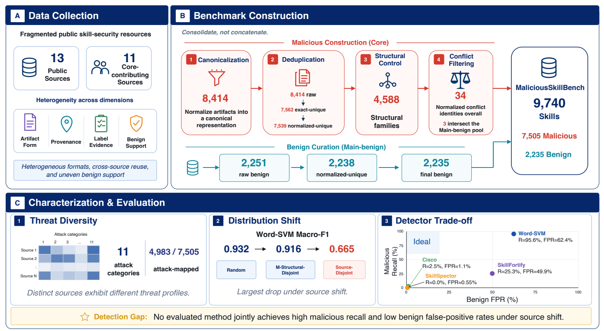
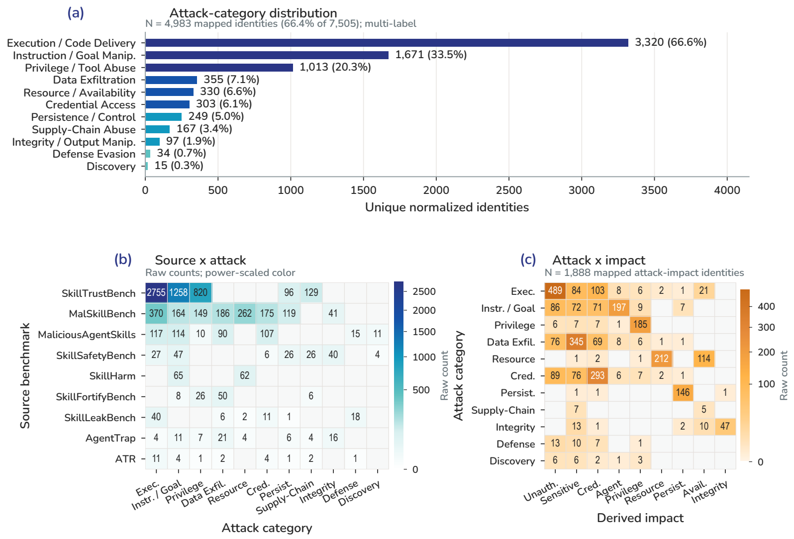
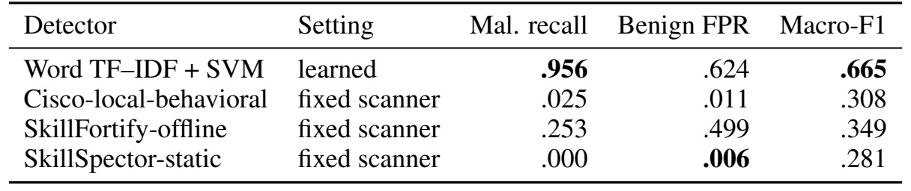

# [论文阅读] MaliciousSkillBench · 换一批来源，恶意 Skill 检测器还准吗？

如果一个检测器擅长识别训练数据里常见的攻击模板，把同一模板的变体随机分到训练集和测试集，分数可能很高。换到一个新平台后，正常 Skill 的说明、配置示例和任务流程也会变。此时，检测器可能依旧能找出大多数恶意样本，却把大量正常 Skill 一并拦下。

MaliciousSkillBench 把这个问题做成了可比较的实验。作者整合 13 个公开来源，先厘清哪些记录指向同一份内容、哪些样本共享模板、哪些内容的标签有冲突，再用不同的数据切分测试检测器。在未见来源上，词级 SVM 找到了 95.6% 的恶意 Skill，同时误报了 62.4% 的正常 Skill。

| 项目 | 内容 |
| --- | --- |
| 论文标题 | MaliciousSkillBench: A Comprehensive Benchmark for Malicious Agent Skill Detection |
| 作者 | Yue Wang、Yi Liu、Gelei Deng、Ying Zhang、Yuekang Li、Zhenyu Chen、Leo Zhang |
| 阅读版本 | arXiv:2608.19901v1，2026 年 8 月 20 日 |
| 研究关键词 | Agent Skill 恶意检测、供应链安全、数据集整合、结构复用、跨来源泛化 |
| 论文 | [arXiv v1](https://arxiv.org/abs/2608.19901v1) · [PDF](https://arxiv.org/pdf/2608.19901v1) |
| 代码与数据 | [官方 GitHub](https://github.com/protectskills/MaliciousSkillBench) · [Hugging Face 数据集](https://huggingface.co/datasets/ProtectSkills/MaliciousSkillBench) |

[研究背景](#background) · [核心方法](#method) · [实验设计](#experiments) · [关键结果](#results) · [贡献与局限](#limits) · [个人理解](#perspective) · [总结](#conclusion)

## 一、研究背景：为什么合并数据集之后还要重做评测？

Agent Skill 可以把说明、脚本、资源和配置打成一个可复用的能力包。评估安装前的恶意检测，需要有证据支持的恶意标签，也需要能检验误报的正常样本。现有数据来自真实市场、人工构造的变体、运行验证的样本和扫描器输出。各来源发布的对象和证据强度不同，正常样本的覆盖也不均衡。

直接拼接数据会把三类问题混在一起。同一文件可能被多次收录，内容不同的样本可能来自同一文档模板，相同内容还可能在不同来源被标成不同类别。即使测试集没有重复文件，检测器也可能接触过相似模板或同一来源的写作风格。作者因此把研究切入点放在**样本身份、标签证据和数据切分**上，先固定这些规则，再比较检测器表现。

## 二、核心方法：先去除重复样本，再控制模板复用

*原文图 1（PDF 第 2 页）。A 汇总来源差异，B 展示恶意与正常两条样本处理流程，C 概括威胁覆盖和跨来源评测。C 中的来源与攻击类别矩阵为示意，实际分布见原文图 2。*

### 1. 统一记录格式，保留来源证据

作者固定 13 个公开来源的版本，把记录整理到统一的数据结构中，保存原始标签、来源版本、样本类型、标签强度、证据和可追溯的派生关系。主恶意集合要求能取得实际 Skill 内容、追溯到固定来源，并保留该来源的恶意判断与支持证据。漏洞条目、仅由扫描器标记的记录和环境配置作为辅助资料。符合条件的 11 个来源贡献了 **8,414 条原始恶意记录**（§4.1–4.2）。

保留证据字段有实际作用。市场观察、运行验证和构造样本可以放进同一份数据清单，同时仍能追查每个标签的依据。有些历史样本来自原作者提供的快照，论文另外记录了获取和再分发条件。

### 2. 区分内容重复与模板复用

| 判断层次 | 实现 | 对评测的作用 |
| --- | --- | --- |
| 内容完全相同 | 对原始 Skill 内容计算 SHA-256 | 将 8,414 条恶意记录减为 7,562 个内容身份 |
| 只有格式差异 | 统一换行、清理行尾空格等，再计算哈希 | 得到 7,539 个规范化恶意身份，保留代码、标点和正文语义 |
| 共用文档模板 | 对域名、路径、长标识符等变量位置做归一化，保留读取、发送、执行等行为词，再按静态相似度分组 | 形成 4,588 个结构组，用于审计及控制训练和测试之间的模板复用 |

第三层决定了论文如何处理“换了地址、路径或参数，文档组织仍相似”的样本。作者将连续三个词元的重合度、TF–IDF 余弦相似度、结构行重合度、行为词重合度和词元包含度加权。达到固定阈值 **0.68** 的样本对相连，互相连通的样本归为一组。因此，两个样本即使互相相似度较低，也可能通过中间样本进入同一组。附录 C 记录了 15 个可能有链式连接的组，并用 LLM 对旧分组中抽取的 72 对同组样本做了盲审。结构组的证据范围限于静态模板相似（§4.3、附录 C）。

### 3. 筛选正常样本，排除标签冲突

正常侧要求有可检查的 Skill 内容及较强或中等的正常证据。仅仅在市场上未被标记、或一次扫描结果为干净的记录，留在辅助集合。2,251 条主正常候选经规范化后剩 2,238 个。跨标签审计发现 34 个冲突身份，涉及恶意侧 34 个候选和主正常侧 3 个候选。作者将冲突组整体排除，保留审计记录，最终得到 **9,740 个 Skill，其中 7,505 个恶意、2,235 个正常**（§4.4、附录 D）。

### 4. 对齐攻击类别，检查每个来源覆盖了什么

作者使用来源已有标签和可确定的语义映射，为 4,983 个恶意身份对齐出 11 个可同时出现的攻击类别，占全部恶意样本的 66.4%。在这部分样本中，3,320 个涉及执行或代码投递，其中 2,755 个来自 SkillTrustBench。这个集中度说明，汇总结果会受来源构成影响。攻击类别以外，作者为 2,128 个身份做了更保守的影响映射，两套映射的交集是 1,888 个（§5）。

*原文图 2（PDF 第 7 页）。a 的百分比以 4,983 个有攻击映射的样本为分母，同一身份可计入多类。b 的单元格是来源与类别的计数。c 展示 1,888 个同时有两类映射的样本中，攻击与派生影响的共现。*

## 三、实验设计：把“见过什么”变成可检查的条件

三种主要切分使用同一张已去重、排除标签冲突的样本表。第四种 Source-Balanced Random 在来源与标签的组合内尽量分层，用来检查随机划分中的来源构成（§6.1、附录 F）。

| 切分 | 约束 | 对应问题 |
| --- | --- | --- |
| 随机 | 按标签以 70/10/20 划分，来源与结构组可跨分区 | 在相近的样本构成下能做多好？ |
| 恶意结构组隔离 | 同一恶意结构组只进入一个分区，正常样本按单条处理 | 控制恶意模板复用之后，分数会降多少？ |
| 来源隔离 | 将 SkillHarm、ATR Skill Security 和 SkillFortifyBench 整体留作测试，排除 8 个跨训练侧与测试侧来源的身份 | 换成未见来源后，误报和漏报会怎样变化？ |

来源隔离的测试集包含 **839 个恶意和 545 个正常** Skill。该切分仍有跨分区的结构组，控制的是来源重合。三个学习基线只看静态主说明文本，分别采用词级 TF–IDF 加逻辑回归、词级 TF–IDF 加线性 SVM、字符级 TF–IDF 加线性 SVM。TF–IDF 用词或字符片段在文档中出现的情况表示文本。来源 ID、证据强度等字段用于审计，未作为特征。

三个现成扫描器读取同样的静态 `SKILL.md`，使用各自固定的本地配置。论文同时报告 **Macro-F1**（恶意与正常两类 F1 的平均）、**恶意召回率**（恶意样本中检出的比例）和**正常误报率**（正常样本中被标成恶意的比例）。三者分别衡量整体分类表现、漏检和误拦（§6.1、附录 G、J）。

## 四、关键结果：主要退化来自正常样本被误报

**结构组隔离的分数下降较小，来源隔离的下降更明显。** 词级 SVM 的 Macro-F1 从随机切分的 **0.932** 降至恶意结构组隔离的 **0.916**，再对照来源隔离时的 **0.665**。三个学习基线在来源隔离下集中于 0.653–0.665。各切分分别训练模型，分数对照反映的是不同训练与测试条件下的表现（原文表 2）。

**来源隔离中的主要错误是误报。** 词级 SVM 漏掉了 839 个恶意样本中的 37 个，误报了 545 个正常样本中的 340 个。正常误报率从随机切分的 9.4% 升到 62.4%，其中 293 个误报来自 ATR Skill Security。把各分区的恶意和正常样本数量配平后，该模型在来源隔离下的误报率降到 43.3%，Macro-F1 升至 0.710。去掉预先确定的构造包装标记后，随机和来源隔离之间仍有差距（§6.3、附录 H–I）。

**两个低误报扫描器漏掉了绝大多数恶意样本。** 在同一来源隔离测试集上，Cisco 的正常误报率约为 1.1%，恶意召回率为 2.5%。关闭 LLM 的 SkillSpector 误报率约为 0.55%，没有检出恶意样本。SkillFortify 的召回率为 25.3%，误报率为 49.9%。这些数字对应论文固定配置下的工作点，训练型 SVM 与固定扫描器的对照衡量的是实际判定表现（§6.4）。

*原文表 3（PDF 第 8 页）。各值以小数表示。SkillSpector 的误报率在表中按三位小数显示为 .006，正文给出约 0.55%。三个扫描器在该测试集上的覆盖率均为 100%。*

## 五、贡献与局限

这篇论文的主要贡献是一套可追溯的评测基准。固定来源版本、身份哈希、结构组、冲突排除规则和切分清单后，后续检测器可以沿用相同测试条件，也可以按来源回查错误。正式数据的每个身份都有公开可读表示，其中 9,735 个提供原始冻结文本，另 5 个提供脱敏版本。样本包的再分发仍遵循各自的来源条款（附录 L）。

来源隔离同时改变了文档风格、攻击构造、标签政策和类别比例，三个留出来源的恶意比例分别约为 100%、4.4% 和 50%。这组实验量化的是指定来源组合下的迁移难度，无法单独估计某一个因素的影响。正常集合侧重证据质量，覆盖范围也窄于恶意侧（§8、附录 F）。

检测实验围绕静态主说明文件展开。需要结合脚本、资源、配置或运行条件才能确认的行为，超出了这一共同输入设置。论文报告的扫描器结果也取决于本地版本、启用功能和判定门槛（§8、附录 J）。

## 六、个人理解：跨文件检测怎样证明自己的增益？

如果研究一个能联合分析说明、配置和脚本的检测器，可以先在这篇论文的静态文本设置上建立基线，再在同时具备完整包的子集上做配对实验。让同一批样本分别接受主说明检测和整包检测，额外记录文件是否齐全、关键操作是否只能跨文件拼接出来，以及正常 Skill 是否也会出现类似的数据流。

结果可以同时给出恶意召回、正常误报和人工复核量，并按来源列出容易误报的正常任务。进一步在相同召回水平下比较两种输入的误报率，可以检验附加文件提供的证据是否真的改善了判定。结构组隔离和来源隔离都值得保留，两种切分分别检查模板复用与跨来源迁移。

## 七、总结

MaliciousSkillBench 先处理数据来源、重复、模板与标签冲突，再把检测器放到不同的切分条件下。词级 SVM 在随机切分上的 Macro-F1 达到 0.932，换到指定留出来源后降至 0.665。恶意召回仍有 95.6%，正常误报却达到 62.4%。这套基准为后续方法提供了可重复的条件，用来检验新证据能否在检出攻击的同时减少对正常 Skill 的误拦。

论文图表来源为 arXiv:2608.19901v1，正文使用第 2 页图 1、第 7 页图 2 和第 8 页表 3。 [论文原文](https://arxiv.org/pdf/2608.19901v1)
