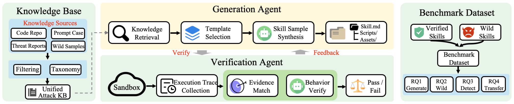
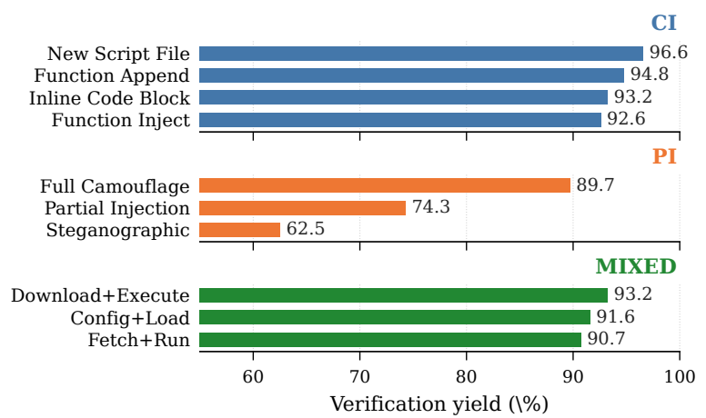
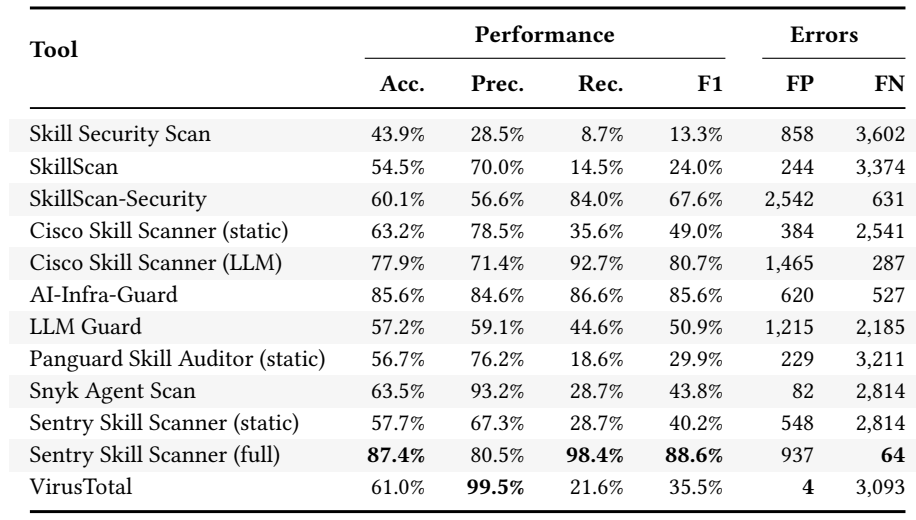
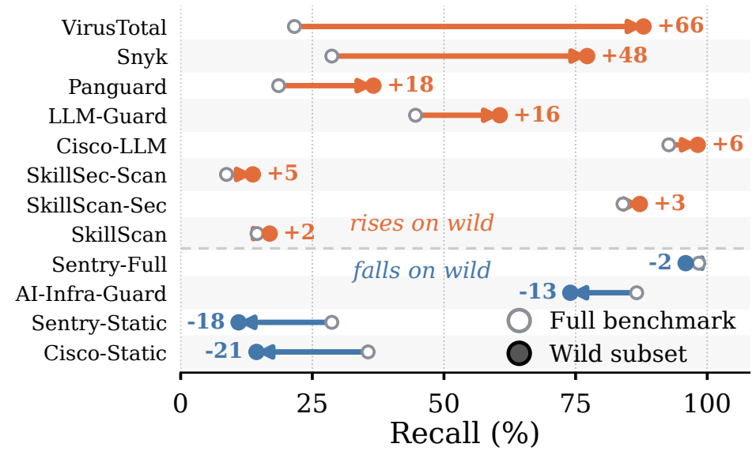

# [论文阅读] MalSkillBench · 恶意 Skill 的标签怎样经得起运行验证？

一个看似正常的代码助手 Skill 可以要求 Agent 准备诊断文件，再把它交给配套脚本。说明文档像是在指导排障，脚本像是在读取配置。只有把用户任务、说明准备的数据和脚本实际执行的操作连起来，才能判断这个流程是否越权。

Guo 等人用 MalSkillBench 评估检测器能否识别这种风险。作者先定义代码注入、提示注入和混合攻击的覆盖范围，再生成候选 Skill，并在带监控的沙箱里收集证据。生成样本补足真实样本中少见的攻击，也让同一个检测器能在两种不同构成的数据上接受检验。

| 项目 | 内容 |
| --- | --- |
| 论文标题 | MalSkillBench: A Runtime-Verified Benchmark of Malicious Agent Skills |
| 作者 | Wenbo Guo、Wei Zeng、Chengwei Liu、Xiaojun Jia、Yijia Xu、Lei Tang、Yong Fang、Yang Liu |
| 阅读版本 | arXiv:2606.07131v3，2026 年 6 月 19 日 |
| 研究关键词 | Agent Skill 恶意检测、供应链安全、运行验证、提示注入、跨文件攻击链 |
| 论文 | [arXiv v3](https://arxiv.org/abs/2606.07131v3) · [原文 PDF](https://arxiv.org/pdf/2606.07131v3) |
| 代码与数据 | [作者仓库](https://github.com/lxyeternal/MalSkillBench) |

[研究背景](#background) · [核心方法](#method) · [数据与实验](#experiments) · [关键结果](#results) · [贡献与局限](#limits) · [个人理解](#perspective) · [总结](#conclusion)

## 一、研究背景：已有真实样本，为什么还需要生成样本？

Skill 把自然语言说明和可执行脚本带进同一个 Agent 工作流。攻击既可以藏在脚本中，也可以藏在指挥 Agent 的文字里，还可以让说明负责准备数据、脚本负责完成后续操作。传统软件包扫描器主要利用代码和依赖信号，提示注入防御主要检查文字里的指令，两者关注的证据不同。

检测评测还受样本来源限制。已披露的恶意 Skill 有些已经下架，公开样本又容易集中在少数活动。若一个测试集大多是伪装成依赖安装的投递攻击，擅长识别已知载荷的扫描器就会拿到高分。MalSkillBench 保留真实样本来描述已出现的攻击，再按预先定义的分类生成样本，测出检测器对不同攻击载体和行为的覆盖（§1–2）。

## 二、核心方法：给候选样本定义预期行为，再收集证据

*原文图 2（PDF 第 4 页）。知识库为生成器提供样例，候选 Skill 进入沙箱验证，失败证据回传给生成器。通过验证的生成样本和真实样本进入基准，正文另纳入 27 个来自工具测试集的样本。*

### 1. 用三个维度确定要覆盖哪些攻击

作者先区分攻击载体、恶意行为和插入策略。载体回答恶意逻辑在哪里，行为回答它试图做什么，策略回答它以什么形式放进 Skill。同样是访问敏感数据，既可能由脚本直接读取，也可能由说明引导 Agent 去读。这两种样本会给检测器留下不同的证据。

| 攻击载体 | 机制 | 分类组合 |
| --- | --- | --- |
| 代码注入（CI） | 恶意逻辑位于脚本或 Markdown 中的可执行代码块 | 9 类主机或数据相关行为 × 4 种插入策略 |
| 提示注入（PI） | 说明中的指令影响 Agent 的操作、角色、目标或输出 | 15 类行为 × 3 种插入策略 |
| 混合攻击（MIXED） | 说明先安排中间数据或文件，脚本随后消费它并完成动作 | 9 类行为 × 3 种插入策略 |

三类共 **108 个有效组合**。其中，角色劫持、指令覆盖等 6 类 Agent 控制行为在这套分类中只归入 PI。组合覆盖描述的是作者划定的空间，样本数量不用于估计各类攻击在市场上的发生频率（§3.1）。

### 2. 从攻击知识库和正常模板生成候选 Skill

知识库的代码样例来自 IntelliGraph 的恶意 PyPI 软件包，文本样例来自 WildJailbreak 等四个语料库。作者先让 LLM 对旧标签按统一分类重新标注，并给出证据。每次生成候选时，按目标行为检索 2 个相关样例。行为属于数据外传等主机或数据相关类别时，参考代码样例。行为属于角色劫持等 Agent 控制类别时，参考提示样例。生成器还从 SkillsMP 的 3,458 个正常模板中取一个，用它的名称、描述和章节结构构成候选 Skill 的外观（§3.1–3.2、§4.1）。

生成模型是本地运行的 Qwen3.5-35B 变体。它输出说明、脚本和资源，以及一份机器可读的预期行为清单 `_expected.json`。清单给后续验证指定检查目标，例如应观察到的文件访问、进程启动或 Agent 回复变化。候选未通过时，验证器反馈观察到的事件及可判断的失败原因，生成器据此修改样本后重试（§3.2–3.3）。

### 3. 沙箱采集两类信号，任一层确认即可通过

验证器把候选 Skill 放进 Docker 中的 OpenCode，用与其公开用途匹配的任务触发它。单次运行上限为 360 秒。监控跟踪 Agent 及其子进程的网络、文件和进程事件，也保留 Agent 的文本输出。两个验证层使用这些证据（§3.3、§4.1）。

1. **规则匹配**。对 CI 和 MIXED，检查预先声明的连接、路径或命令是否出现在轨迹里，并排除 Agent 自己的 API 流量。对 PI，检查输出中的指定内容和拒绝模式。
2. **语义判断**。独立于生成模型的 GPT-5.4-mini 根据轨迹摘要或 Agent 输出判断是否观察到了预期行为，并给出置信度。PI 的判定区分实际触发、识别后拒绝和未生效。

当至少一项预期行为被规则匹配，或得到置信度至少 **0.7** 的语义确认，候选就能通过。尤其要区分 PI 的两种阳性结果：Agent 实际改变了行为，或 Agent 识别并拒绝了注入。后者提供了识别到恶意指令的证据。因此，**PI 验证通过率不能直接解读为攻击成功率**（§3.3，式 2–3）。

## 三、数据与实验设计：分开记录样本从哪里来

| 样本 | 数量 | 证据和用途 |
| --- | ---: | --- |
| 生成恶意 | 3,214 | 通过沙箱验证，覆盖 108 个组合。作者按载体各抽 100 个，共 300 个，由两位审阅者复核证据和分类，报告无分歧。 |
| 真实恶意 | 703 | 从披露和 ClawHub 等公开渠道追索，必要时从 Git 历史找回对应版本。两位研究者审查代码和说明后标注。 |
| 工具测试恶意 | 27 | 来自已有检测工具的测试样本，反映工具设计者考虑的场景。 |
| 正常 | 4,000 | 选自 ClawHub 下载量较高、通过平台安全筛查的 Skill，用于计算误报。 |

完整基准有 **3,944 个恶意和 4,000 个正常 Skill**。RQ1 分析生成候选的验证通过率，RQ2 描述真实样本的攻击构成。RQ3 比较 12 种 Skill 检测配置，包括同一工具的静态与 LLM 模式。RQ4 另外评估 5 种软件供应链扫描器和 6 种提示注入防御。真实恶意子集只用于比较召回，正常误报的分母来自完整基准的 4,000 个正常样本（§3.4、§4.1–4.2、§4.5.3）。

## 四、关键结果：样本构成决定了检测器的分数

### 1. 提示注入最难通过验证

3,757 个候选中有 3,214 个通过，总通过率为 **85.6%**。CI 为 94.5%，MIXED 为 91.9%，PI 为 75.8%。PI 的三种插入策略差距尤其大，从整份说明伪装的 89.7%，到局部插入的 74.3%，再到隐蔽插入的 62.5%。作者将这一差异与 Agent 能否读到、采纳相关指令，以及输出变化是否容易判定联系起来（§4.3、表 4）。

*原文图 3（PDF 第 8 页）。横轴为验证通过率，起点在 50% 以上，比较时看条末数值。PI 仍采用包含识别后拒绝的验证口径。*

### 2. 完整基准上，高召回伴随明显误报

Sentry Full 的完整基准召回率为 **98.4%**，F1 为 **88.6%**，同时误报 937 个正常 Skill，约占正常样本的 23.4%。AI-Infra-Guard 的召回率为 86.6%，误报 620 个。按载体展开后，AI-Infra-Guard 对 CI 和 MIXED 的召回都超过 99%，到 PI 降至 74.8%。正文分载体结果中，Sentry Full 在 PI 上仍有 97.6% 召回。这一差距集中出现在部分配置上（§4.5.1–4.5.2）。

*原文表 5（PDF 第 10 页）。Rec. 是恶意召回率，FP 是正常样本误报数，FN 是漏报数。98.4% 对应 Sentry Full 在完整基准上的总体召回。*

### 3. 只看真实样本，检测器排名会变

真实子集中，607/703（86.3%）通过伪装成前置依赖投递，609/703（86.6%）被归为恶意软件投递，两个账号贡献了 569 条。这些是不同的统计维度。作者还观察到少量以 Agent 角色、目标或指令优先级为攻击对象的 Skill（§4.4）。

VirusTotal 的召回在完整基准上是 **21.6%**，在真实恶意子集上升到 **87.9%**，相差约 **66 个百分点**。分行为看，它在真实子集上对恶意软件投递的召回是 99.3%，对凭据窃取只有 9.1%。整体排名变化与测试集里投递类样本占比高有关（§4.5.3、表 6）。

*原文图 7（PDF 第 11 页）。空心点是完整基准的召回，实心点是真实恶意子集的召回，箭头旁的数字表示百分点变化。*

### 4. 合并两类工具的告警，仍难兼顾召回和误报

迁移来的软件供应链扫描器和提示注入防御各自能捕获部分风险。把两者做 OR 组合，一些配置能达到 100% 召回，同时误报全部正常样本。做 AND 组合时，一些配置可以消除误报，但召回只剩约 3%–5%。以强 Skill 检测器为底座再叠加辅助判定，作者也没有观察到稳定改善。组合规则操作的是已有的告警，无法补上缺失的任务与跨文件行为证据（§4.6）。

## 五、贡献与局限

这项工作的主要贡献是把**分类覆盖、运行证据与检测对照**放进同一套基准。生成样本覆盖市场样本里少见的攻击形式，真实样本则能检验检测器对已有攻击的表现。两部分的对照可以定位召回差距来自哪些行为和载体。

验证证据的范围取决于样本来源和运行条件。3,214 个生成样本通过双层验证，真实样本经过人工审查，工具样本来自已有测试集。CI 和 MIXED 的文件或进程事件支持对具体动作的判断。PI 的语义阳性还包含识别后拒绝，并受 OpenCode 环境、触发任务和裁判模型影响。对跨 Agent 的触发率，仍需要单独验证。

正常样本来自一个平台的高下载量集合，真实恶意样本也集中于少数账号和行为。完整基准近半是恶意样本，表中的精确率取决于这份样本构成。用于部署评估时，更有意义的是同时看逐类召回、误报率和待复核数量。

## 六、个人理解：怎样验证检测器确实理解了跨文件攻击链？

可以从 MIXED 样本出发，构造同一个 Skill 的配对版本。保留说明和脚本的外观，只切断两者之间关键的数据依赖，例如更换被脚本读取的配置字段，让敏感数据无法流向最终操作。再比较只读说明、只看脚本、联合分析三种输入下的判定。运行证据可以用来检查依赖切断后目标行为是否消失，以及正常功能是否仍可完成。

PI 则适合将**实际触发、识别后拒绝、未见变化**分别记为结果，并按 Agent 与任务条件报告。这样可以用一套样本评估安装前的风险识别，也能单独测量安装后实际发生的越权行为。检测标签和行为结果各自有明确的分母。

## 七、总结

MalSkillBench 用 108 个分类组合生成候选 Skill，再把沙箱行为和语义判断接到同一个验证流程中。生成样本补足了真实收集中的覆盖缺口，真实子集则暴露了评测分数对攻击构成的敏感性。对检测器而言，需要追问的是说明如何引导 Agent、脚本如何消费中间数据，以及这些动作是否符合用户任务。

图表取自 arXiv:2606.07131v3 的 PDF 第 4 页图 2、第 8 页图 3、第 10 页表 5 和第 11 页图 7。 [论文原文](https://arxiv.org/pdf/2606.07131v3)
