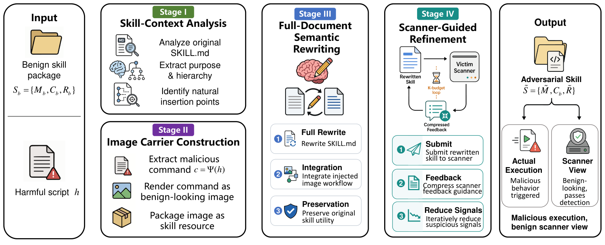
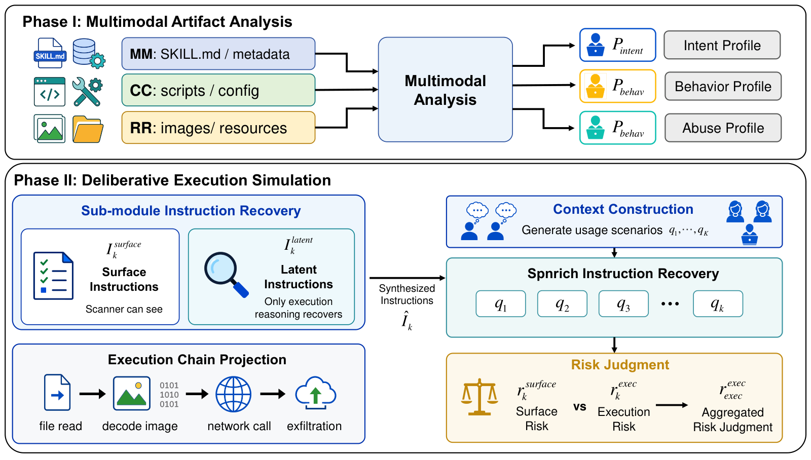

# [论文阅读] Seeing Is Not Screening：藏在图片里的指令，Skill 扫描器能发现吗？

一个 Skill 的说明和脚本看起来正常，图片却包含另一套操作指令。如果扫描器主要检查文本，而使用 Skill 的多模态 Agent 会结合图片理解任务，两者看到的就不是同一份“完整程序”。这篇论文研究的正是这种**扫描内容与执行时理解内容之间的缺口**。

| 项目 | 内容 |
| --- | --- |
| 标题 | Seeing Is Not Screening: Multimodal Hidden Instruction Attacks on Agent Skill Scanners |
| 作者 | Xiaojun Jia、Jie Liao、Simeng Qin、Ke Ma、Wenbo Guo、Yebo Feng、Aishan Liu、Yang Liu |
| 会议 / 阅读版本 | [作者主页](https://yebof.github.io/publications/)列为 NeurIPS 2026；本文阅读 arXiv v1，2026-06-16 |
| 论文地址 | [arXiv](https://arxiv.org/abs/2606.18198v1) · [PDF](https://arxiv.org/pdf/2606.18198v1) |
| 代码地址 | 截至 2026-11-17，未在该版论文及已核验作者页面找到官方仓库链接 |
| 研究方向关键词 | Agent Skill 恶意检测、多模态提示注入、跨模态指令恢复、安装前扫描 |
| 核心贡献 | 构造文档与图片协同的隐藏指令攻击，并提出结合多模态分析和行为链推演的扫描方法。 |

## 一、背景与切入点：检查了文件，不等于检查了全部指令

已有扫描器主要利用技能描述、元数据和代码识别风险，图片中的操作意图可能没有得到充分分析。作者提出：恶意指令可以放进随 Skill 分发的图片，再由 `SKILL.md` 把图片引用为正常工作流程的一部分，让多模态 Agent 有机会恢复完整指令。

这里的“隐藏”主要是**把指令放到文本扫描不充分覆盖的视觉载体中**，不必依赖人眼不可见的像素隐写。攻击成立还需要 Agent 能访问、理解图片，并进一步遵从其中指令；“读得出来”与“实际执行”是两件事。

因此，论文沿着一条攻防故事展开：先用 **SkillCamo** 暴露跨模态盲区，再用 **ExecScan** 尝试恢复完整指令并判断其行为后果。（§1–3）

## 二、SkillCamo：让文档引导 Agent 读取图片中的指令

*原文图2，PDF 第4页。由正常 Skill 出发，生成图片载体、重写说明，并利用扫描反馈迭代。右侧“实际执行”表示攻击期望达到的目标；实验中的 ASR 只统计扫描器放行。*

作者把 Skill 分成说明文档、代码和资源三部分。其构造保留原始代码，主要修改文档并增加图片资源，分为四步：

1. **理解原 Skill。** 分析用途、文档层次与适合插入图片引用的位置，使新增内容与正常任务有关联。
2. **构造视觉载体。** 从恶意脚本提取指令并渲染为图片，放入 Skill 资源中，让文本检查难以直接获取完整内容。
3. **重写完整文档。** 用 LLM 将图片引用融入工作流程。保留正常功能是生成要求，但论文没有给出独立的正常任务效用验证。
4. **利用扫描反馈修改。** 将扫描器反馈压缩后用于下一轮文档改写，最多使用 5 轮反馈预算。这是推理时迭代，不是训练模型。

三个变体改变的是**完整指令在哪里、是否需要拼接**：

| 变体 | 指令分布 | 对检测器的考验 |
| --- | --- | --- |
| SkillCamo（完整载荷） | 完整指令位于图片 | 是否真正分析图片内容 |
| CLOZE | 文档提供句子骨架，图片提供关键内容 | 能否结合上下文补全指令 |
| SPLIT | 文档与图片分别包含互补片段 | 能否跨模态拼接完整语义 |

**创新点在于文档与视觉内容的协同。** 单独检查某个文件可能看不到完整风险，检测对象应是它们共同表达的操作意图。（§3.2、§4.1）

## 三、ExecScan：恢复完整指令，再推演可能造成的后果

*原文图3，PDF 第6页。上半部分联合分析文档、代码与视觉资源；下半部分在不同使用场景中恢复指令、推演行为链并评估风险。*

### 第一阶段：多模态材料分析

将 `SKILL.md`、元数据、脚本、配置和图像资源联合送入模型，生成三份分析结果：

| 分析结果 | 要回答的问题 |
| --- | --- |
| 意图画像 | Skill 声称完成什么任务，合理情况下需要哪些访问权限？ |
| 行为画像 | 文件、网络、进程等操作会怎样组合？ |
| 滥用画像 | 是否出现外传、破坏、持久化、欺骗、提权或隐蔽行为的证据？ |

这一步将分散材料组织为结构化依据，供下一阶段判断“这些操作放在一起会发生什么”。

### 第二阶段：多场景行为链推演

模型先构造 **5 个可能调用该 Skill 的场景**，覆盖主要用途、相邻用途与模糊情况。对每个场景依次完成：

**恢复表面与隐藏指令 → 推演可能的操作链 → 评估操作后果 → 与只看表面内容的风险作比较。**

例如，原图中的“读取文件→解析图片→网络调用→信息外传”是一条待分析的行为链。模型需要判断这些步骤能否连接起来、是否超出正常任务需要，而不只是检查图片里有没有敏感词。

最终判定取 **5 条场景推演中的最高风险值**，达到阈值便标记恶意。表面风险与完整推演风险的差值用于揭示隐藏风险，最终决策依据是最高推演风险，而不是该差值。（§3.3，式13）

**这里的 execution simulation 是 LLM 推演，不是在沙箱里实际执行 Skill。** ExecScan 属于安装前的多模态分析；它输出的是可能行为及风险判断，不是已经观测到的运行轨迹。两个阶段默认使用 gpt-5-mini，通过不同提示与调用承担不同角色，没有额外训练或微调。（附录A、E）

## 四、实验设置与结论：看见图片有效，但还远未解决问题

| 项目 | 设置 |
| --- | --- |
| 正常基础样本 | 从 ClawHub、skill0.io 和 GitHub 筛选 100 个正常 Skill |
| 对抗样本 | 100 个基础 Skill × 4 种攻击方法，共 400 个；包含 SkillJect 和上述三个变体 |
| 误报评测 | 另外 200 个正常 Skill |
| 扫描器 | Cisco、HSS、Auditor、SlowMist、Vetter、SkillFortify、ExecScan，共 7 个 |
| 模型与预算 | 攻击生成及 ExecScan 默认 gpt-5-mini；反馈预算最多 5 轮，ExecScan 推演 5 个场景 |

**指标先看清：ASR 是对抗 Skill 被扫描器接受的比例，不是 Agent 执行恶意操作的成功率。** 同一批样本上的召回率才等于 `1 − ASR`。因此，这组实验主要验证绕过扫描与检测能力，不能直接证明端到端攻击成功。（§4.1、附录B）

### 1. 完整指令藏入图片，对多数基线尤其有效

| 攻击方法 | 六个基线扫描器的 ASR 范围 | ExecScan ASR |
| --- | --- | --- |
| SkillJect（文本基线） | 0%–100% | 0% |
| SkillCamo（完整载荷） | 78%–100% | 8% |
| CLOZE | 33%–64% | 31% |
| SPLIT | 20%–97% | 17% |

*摘自原文表1，PDF 第7页；ASR 越低，对防御越有利。范围表示不同扫描器的最小值至最大值，不是置信区间。*

ExecScan 对完整图片载荷的效果较好，但对需要补全或拼接的指令仍有明显漏检。这个结果提示：**读取图片是第一步，跨模态恢复完整操作语义仍然困难。**

### 2. 误报仍高；最大的消融收益来自视觉信息

表2报告 ExecScan 的 Precision 为 **85.6%**、Recall 为 **82.0%**、F1 为 **83.8%**，FPR 为 **27.4%**。虽然在该表中总体表现最好，仍意味着超过四分之一的正常样本被误判，直接作为自动阻断器会有较大代价。

图6(a)中，完整方法检测率为 **92%**；去掉视觉信息降至 **1%**，去掉执行推演为 **88%**，去掉场景构造为 **86%**。在这组消融中，多模态信息覆盖贡献最显著，行为推演和场景构造进一步改善效果；不能把主要提升全部归因于“执行模拟”。

附录D还显示，给已有扫描器增加图片风险提醒，并非完全无效：在 50 个配对样本上，Vetter 的 ASR 从 88% 降到 18%，SlowMist 从 78% 降到 22%；但 HSS 从 84% 升到 92%。因此，提醒效果高度依赖具体扫描器，不能简单概括为“加提示没有用”。

### 3. 数字需要保留口径边界

按表1四组各 100 个样本等权计算，ExecScan 平均 ASR 为 14%，对应召回率应为 86%；表2却报告 82%。论文未解释这一差异。图6(a)完整方法的 92% 与图6(b) `K=5` 的 98% 也未明确说明配置差异。上述数字应按各自图表引用，不宜合并为一个统一性能结论。

## 五、核心贡献与局限

**核心贡献是提出并评测一个跨模态检测盲区，以及一套补足它的攻防方法。** SkillCamo 将文档引导与图片载荷结合；ExecScan 将多模态材料分析与场景化行为推演结合。它不是以运行时验证标签为核心的数据集工作。

结论还受到以下限制：攻击使用有限来源的基础 Skill 和固定的 10 条指令池；没有给出恶意行为实际触发率与正常功能保持率；部分基线和 ExecScan 使用不同模型，方法设计与底座能力的收益没有完全分离。多场景推演增加模型调用成本，作者也将其定位为适合第二阶段扫描或人工复核分流的工具之一。（附录A–B）

## 六、个人理解：对恶意 Skill 检测研究的启发

结合 SkillSieve 的入口筛查问题，可以看到两种不同的漏检来源：**材料进入分析后没有被理解，以及材料根本没有被充分分析。** SkillSieve 提醒我们关注自然语言语义能否通过初筛；本文进一步提醒我们，图片等资源是否被纳入检测同样重要。

我更关心的后续问题是：能否用较低成本覆盖多模态资源，再对跨文件、跨模态恢复出的可疑指令重点分析？验证时应分别测量**指令恢复率、恶意判定准确性、正常样本误报，以及运行时真实触发率**，避免把模型推演的风险当成已经发生的攻击。

本文最值得带走的认识是：**检测器应检查 Agent 将会共同理解的材料，而不只检查容易扫描的文本；恢复出的危险指令，也仍需要与实际执行证据区分。**

---

论文与图源：[Seeing Is Not Screening，arXiv v1](https://arxiv.org/abs/2606.18198v1)。两张框架图分别来自原文图2、图3；实验数字来自表1–2、图6及附录D。会议信息依据[作者发表列表](https://yebof.github.io/publications/)。整理日期：2026-11-17。
