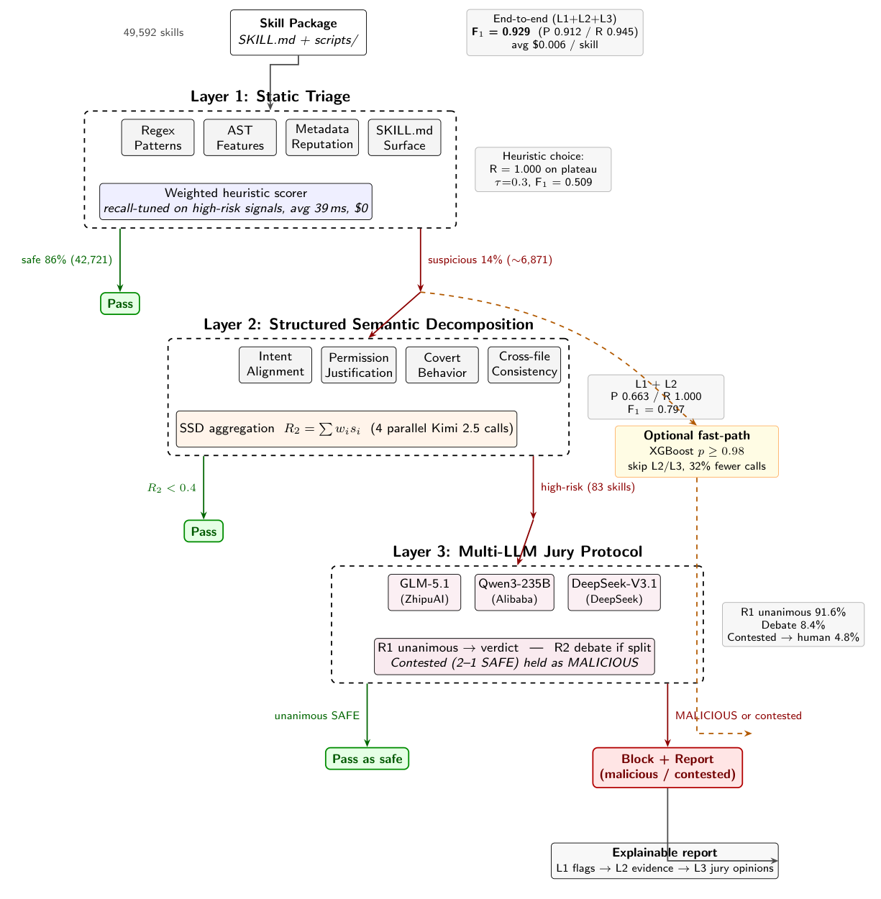

# [论文阅读] SkillSieve：怎样把昂贵的检测留给真正可疑的 Skill？

一个 Skill 读取凭据、访问网络，可能是在完成正常集成，也可能是在窃取数据。只匹配危险词容易误报；只把整个包交给一次 LLM 判断，又难以检查它是否遗漏了某个风险。

SkillSieve 把安装前检测拆成三层：**低成本静态筛查 → 四项语义分析 → 多模型复核**。前面尽量保留可疑样本，后面结合上下文消除误报，并把仍有争议的情况交给人工。

| 项目 | 内容 |
| --- | --- |
| 标题 | SkillSieve: A Hierarchical Triage Framework for Detecting Malicious AI Agent Skills |
| 作者 | Yinghan Hou、Zongyou Yang |
| 阅读版本 | arXiv:2604.06550v3，2026 年 7 月 27 日；作者信息以此版本为准 |
| 论文地址 | [arXiv v3](https://arxiv.org/abs/2604.06550v3) · [原文 PDF](https://arxiv.org/pdf/2604.06550v3) |
| 代码地址 | [xiaohou521/skillsieve](https://github.com/xiaohou521/skillsieve) |
| 研究关键词 | 恶意 Agent Skill 检测、静态筛查、结构化语义分析、多模型复核、检测成本 |
| 核心贡献 | 将静态筛查、四维语义分析和多模型复核组成分层检测流程，按风险分配分析成本。 |

## 一、背景与切入点：危险操作不等于恶意意图

Skill 同时包含自然语言说明与脚本，攻击可以跨文件分散，也可以直接藏在说明里。代码分析难以理解自然语言意图；规则遇到合法凭据处理、长 URL 或安全文档中的攻击示例，又容易误报。作者的切入点是：**先筛出值得深入分析的对象，再分别审查目的、权限、隐蔽性和跨文件关系，最后复核高风险判断。**（§1–4）

这里检测的是**文本包中可见的恶意意图**。系统读取文件并调用远程 LLM，不执行待测 Skill；二进制和只有运行后才取得的载荷不在当前范围内。因此，它与 MalSkillBench 的运行验证承担不同角色：前者判断安装前风险，后者为生成样本收集行为证据。（§3）

## 二、核心方法：三层分别解决什么问题？

*原文图 1，PDF 第 2 页。从上到下看筛查、语义分析和复核。图中的 49,592 与 6,871 来自全量归档扫描；83 个进入第三层的样本及检测指标来自 390 个标注样本，不能当成同一批数据的连续漏斗。*

### 1. 第一层：宁可多送审，也尽量不提前漏掉

第一层从四类信号产生风险分数：约 60 条模式规则；用 Tree-sitter 解析 Python、Bash、JavaScript 得到的语法结构特征；名称相似度、敏感环境变量等元数据；说明长度、URL、敏感路径和催促性措辞等表面统计。解析失败的文件仍接受模式匹配，不直接丢弃。（§4.2）

加权启发式分数低于 **0.3** 就放行，否则进入第二层。作者依据标注集上的满召回区间选择这个阈值，因为**在入口被放行的恶意样本，后面的 LLM 无法补救**。这只是该测试集上的零漏检，不是对新样本的保证。

### 2. 第二层：把“是否恶意”拆成四个可检查的问题

四个并行的 Kimi 2.5 调用分别接收完整 Skill、第一层告警和各自的任务要求，返回风险分数、证据与等级。（§4.3）

| 子任务 | 具体检查什么 | 权重 |
| --- | --- | ---: |
| 意图一致性 | 实际指令是否偏离宣称用途？ | 0.35 |
| 权限合理性 | 文件、网络、环境变量和程序权限是否为任务所必需？ | 0.25 |
| 隐蔽行为 | 是否要求隐瞒动作、绕过安全约束？ | 0.25 |
| 跨文件一致性 | 脚本和命令是否与说明相符，分散内容是否共同暴露风险？ | 0.15 |

四项分数加权求和，结果 **≥0.4** 才进入第三层。例如，说明要求运行外部载荷，而包内脚本目录为空，跨文件检查会把这种不一致作为证据。它关联的是文件内容与指令，**不是执行轨迹，也不是形式化证明**。

### 3. 第三层：不同模型独立判断，分歧时再交换证据

GLM-5.1、Qwen3-235B、DeepSeek-V3.1 独立读取 Skill 和前两层证据。三者结论一致就结束；不一致则相互查看证据，进行第二轮投票。（§4.4，算法 1）

- 一致安全：放行。
- 一致恶意，或第二轮至少两票恶意：判为恶意。
- 第二轮仍为两票安全、一票恶意：标为 **Contested**，暂按恶意阻止并交人工。

这不是简单多数决。作者更担心漏报，因此“多数认为安全”仍可能无法自动放行。评测也把争议样本计为恶意预测，不能把分数理解成人工复核后的结果。

### 4. 可选快速分支：提前判恶意，而非提前判安全

作者另训练 XGBoost，只有恶意预测置信度 **≥0.98** 才跳过后两层，直接判恶意；其他样本继续走完整流程。训练时移除了评测样本路径，阈值由按作者分组的交叉验证确定。作者没有开放“高置信度正常就放行”的分支，因为该做法在未见作者上会漏报。（§6.8）

这一分支减少成本，但不构成主结果。其效果也受来源分布影响：按作者隔离时，XGBoost 的 F1 降到 **0.671**，所以同分布下的节省比例不能直接外推到新作者。

## 三、实验设置：先分清各组样本的用途

| 数据或设置 | 用途 |
| --- | --- |
| 49,592 个 ClawHub Skill，2026-04-04 快照 | 测第一层扫描速度与送审比例，并估算全量 API 成本；不是全部经过人工标注的测试集 |
| 390 个复核样本：55 恶意、335 正常 | 计算主要检测指标；最终标签审查修正过一个“高风险但非恶意”的开发工具样本 |
| 100 个构造对抗样本，每类 20 个 | 测编码、跨文件拆分、条件触发、同形字符、延迟载荷；均围绕凭据窃取构造 |
| 52 个飞书／Lark 包 | 检查跨生态适配和领域相关误报 |
| Orange Pi AIpro，4 核 ARM、24 GB 内存 | 本地运行静态分析；第二、三层通过网络调用远程 LLM |

因此，“在 440 美元单板机上运行”不表示所有大模型都在本地推理。主要结果表对照 ClawVet 默认非语义模式、关闭可选神经模型的 SkillScan，以及自身逐层配置；其他工具还出现在效率比较中，不宜笼统写成对所有基线都完成了同等精度比较。（§5–6，表 1、3）

## 四、实验结论：减少误报有效，但存在漏报代价

### 1. 逐层提高精确率，第三层也放过了三个恶意样本

| 配置 | 精确率 | 召回率 | F1 | 正常样本误报率 |
| --- | ---: | ---: | ---: | ---: |
| 第一层 | 34.2% | 100% | 50.9% | 31.6% |
| 第一层＋语义分析 | 66.3% | 100% | 79.7% | 8.4% |
| 完整三层 | 91.2% | 94.5% | 92.9% | 1.5% |

第二层留下 **55 个真阳性、28 个误报**。第三层将误报减到 **5 个**，但同时漏掉 **3 个恶意样本**。83 个送审样本中，7 个触发辩论，4 个最终保留争议；其中一个恶意样本若直接按多数票放行就会漏检。（§6.2、6.7，表 1、5）

这些结果支持分层复核的整体收益，但没有单独证明收益究竟有多少来自四任务分解、更多模型调用或辩论机制；仍需要等模型、等预算的对照。

### 2. 成本节省主要来自提前筛出低风险样本

第一层在 **31 分钟**内处理 49,592 个 Skill，平均 **37.6 毫秒／个**；6,871 个被标为可疑，约占 **13.86%**。这证明静态筛查能够减少送入 LLM 的数量，不证明被放行的其余样本全都安全。（§6.5–6.6，表 4）

**约 0.006 美元／Skill 是按归档总体送审比例估算的平均 API 成本**，不是每个可疑样本完成深度分析的固定费用。可选快速分支使表 6 中进入后续层的样本数从 161 降到 109，约少 32%；该列虽写作 calls，统计单位是样本，不是逐个 API 请求。召回不变，但多出两个误报，F1 从 92.9% 降到 91.2%。（§6.8，表 6）

### 3. 能识别部分条件与延迟攻击，不等于观察到了触发

100 个构造对抗样本全部检出。条件触发和延迟样本中存在静态规则可识别的线索，其他策略结合语义分析确认。由于系统不执行样本，这说明它发现了**可见文本中的攻击意图**，不是证明沙箱触发了这些行为，也不能推成对所有规避攻击满召回。（§6.4，表 2）

飞书实验中，第一层标记 14 个包，第二层将 13 个改判安全，例如把长 API URL 误作编码、把防注入文档中的示例误作攻击。剩余告警是明文存储凭据的风险；存在安全缺陷，不自动等于作者故意恶意。因此，该实验主要支持语境分析能纠正领域误报，而非全面证明跨生态恶意检测能力。（§7）

## 五、贡献、边界与研究启发

这篇的主要贡献是**组织检测流程**：静态层控制调用量，四项语义任务提供分项证据，多模型复核降低误报并暴露分歧。它还提供实现、标签和实验材料，适合作为后续恶意 Skill 检测方法的对照。

边界集中在三处：**入口漏报无法追回**；只有运行后才出现的载荷不在静态可见范围；390 个标注样本、同作者偏重的分布和有限对抗模板，限制了泛化结论。LLM 即使温度为 0 也可能变化，作者也说明发布规则经过后续调整，论文结果应视为固定版本、固定运行的记录。（§4.2、6.8、8）

**公开资源也要分清**：作者仓库提供核心代码，以及包含来源路径、标签依据和 390 个评测子集标记的索引；不重新分发第三方 Skill 包，也不公开原始 LLM 回复等中间材料。复现时需要找回对应归档版本，不能直接把当前同名 Skill 与旧标签配对。[仓库数据说明](https://github.com/xiaohou521/skillsieve#public-data)

个人理解：可以把它与 MalSkillBench 的运行验证结合起来研究，但先区分“静态未识别”与“运行未触发”。对同一攻击构造显式、条件触发、延迟和运行时取回等版本，分别记录入口是否放行、语义层是否识别、运行是否取得证据。再用按作者或攻击模板隔离的测试，检验方法是否理解了风险，而不只是记住熟悉模式。

SkillSieve 留下的核心问题是：**怎样在有限成本下，把需要深入判断的样本送到合适的分析层，同时避免入口漏报和复核过度放行？**

---

原图取自 arXiv:2604.06550v3 PDF 第 2 页图 1。方法与实验对应原文 §3–8、算法 1、表 1–6；代码与公开数据范围核对于 2026-11-17。
